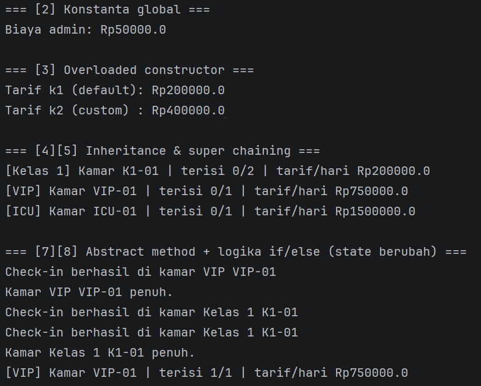
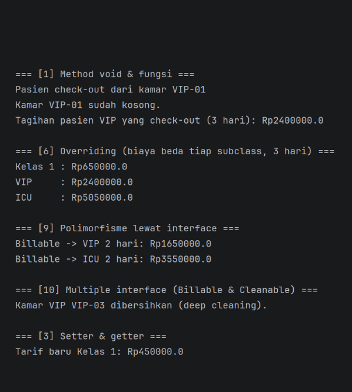

# Sistem Kamar Rawat Inap Rumah Sakit

## Identitas
- Nama : Affan Ramadhan
- NIM  : H1D025126
- Tema : Rumah Sakit

## Cara Compile dan Run (Terminal)
```bash
cd src
javac *.java
java Main
```
Membutuhkan JDK 8 atau lebih baru.

## Struktur Class
| File | Keterangan |
|---|---|
| `src/Kamar.java` | abstract class (superclass) |
| `src/KamarVIP.java`, `src/KamarKelas1.java`, `src/KamarICU.java` | subclass |
| `src/Billable.java`, `src/Cleanable.java` | interface |
| `src/Main.java` | alur pengujian |

## Screenshot Luaran


